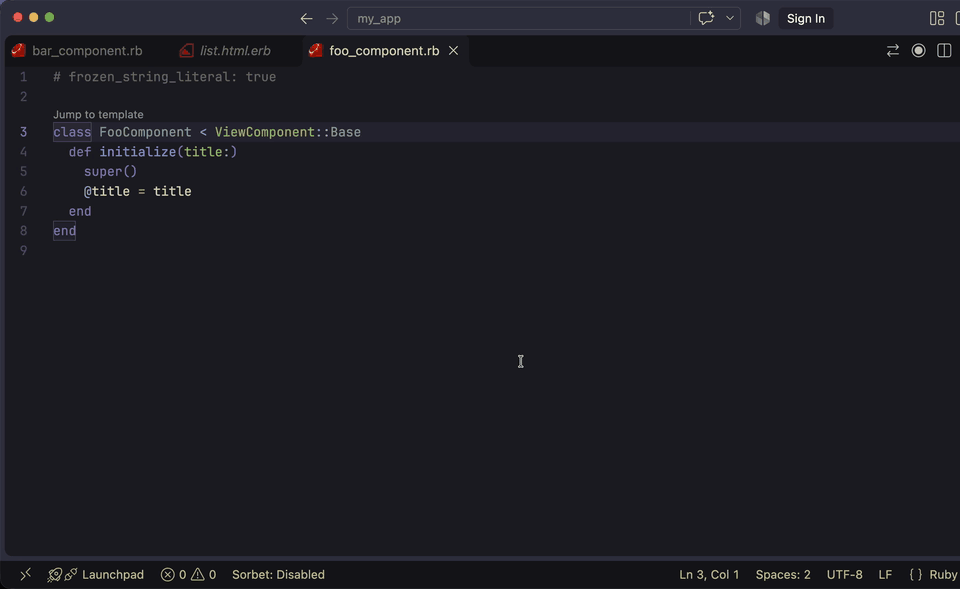
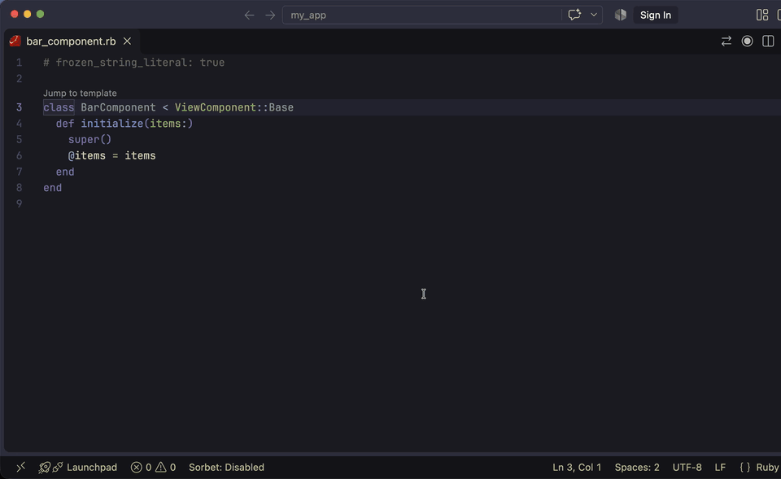
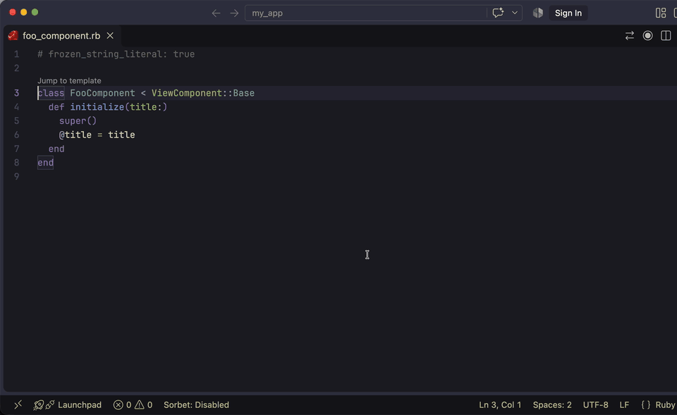

# ruby-lsp-view_component

A [Ruby LSP](https://github.com/Shopify/ruby-lsp) add-on for [ViewComponent](https://viewcomponent.org). It adds a `Jump to template` CodeLens to each component class that opens the component's template, or lets you create it when it is missing.

## Features

### Jump to template

The lens sits above the component class. When the component has a single template, a click opens it.



When the component has more than one template, the click opens a picker with the main template first.



For `app/components/foo_component.rb` with all of these templates, the lens lists:

| File | What it is |
|---|---|
| `foo_component.html.erb` | [Main template](https://viewcomponent.org/guide/templates.html#sibling-file) |
| `foo_component.html+phone.erb` | Variant of the main template |
| `foo_component/foo_component.html.erb` | [Main template in a subdirectory](https://viewcomponent.org/guide/templates.html#subdirectory) |
| `foo_component/list.html.erb` | Sub-template rendered with `call_list`, from [view_component_subtemplates](https://github.com/bukhr/view_component_subtemplates) |

ERB, Haml and Slim templates are supported. Templates of nested components in the subdirectory, such as `foo_component/item_component.html.erb` next to `foo_component/item_component.rb`, belong to that component and are left out.

### Missing template

When a component needs a template and has none, the lens opens `foo_component.html.erb` next to the class. VS Code reports that the file does not exist and offers a **Create File** button. Once the file exists, the same lens opens it.



A component counts as needing a template only when it renders through a template file. There is no lens for components that:

- define [`call`](https://viewcomponent.org/guide/templates.html#call), themselves or in a parent class
- declare an [inline template](https://viewcomponent.org/guide/templates.html#inline) with `erb_template`, `haml_template` or `slim_template`
- [inherit](https://viewcomponent.org/guide/templates.html#inherited) a template from a parent class
- are marked `abstract!`

A base class that is never rendered on its own still gets the lens. Mark it `abstract!` to hide it.

## Installation

Add the gem to your application's Gemfile:

```ruby
group :development do
  gem "ruby-lsp-view_component", require: false
end
```

Run `bundle install` and restart Ruby LSP. Ruby LSP loads add-ons from the bundle, so there is nothing to configure.

## Development

```bash
bundle install
bundle exec rake
```

`rake` runs the tests and RuboCop.

## Release

1. Update the version in `lib/ruby_lsp_view_component/version.rb` and add it to `CHANGELOG.md`.
2. Run `bundle exec rake release`. It builds the gem, tags the commit as `vX.Y.Z`, pushes the tag and pushes the gem to RubyGems. The gem requires MFA, so `gem push` asks for a one-time code.

## License

[MIT](LICENSE.txt)
